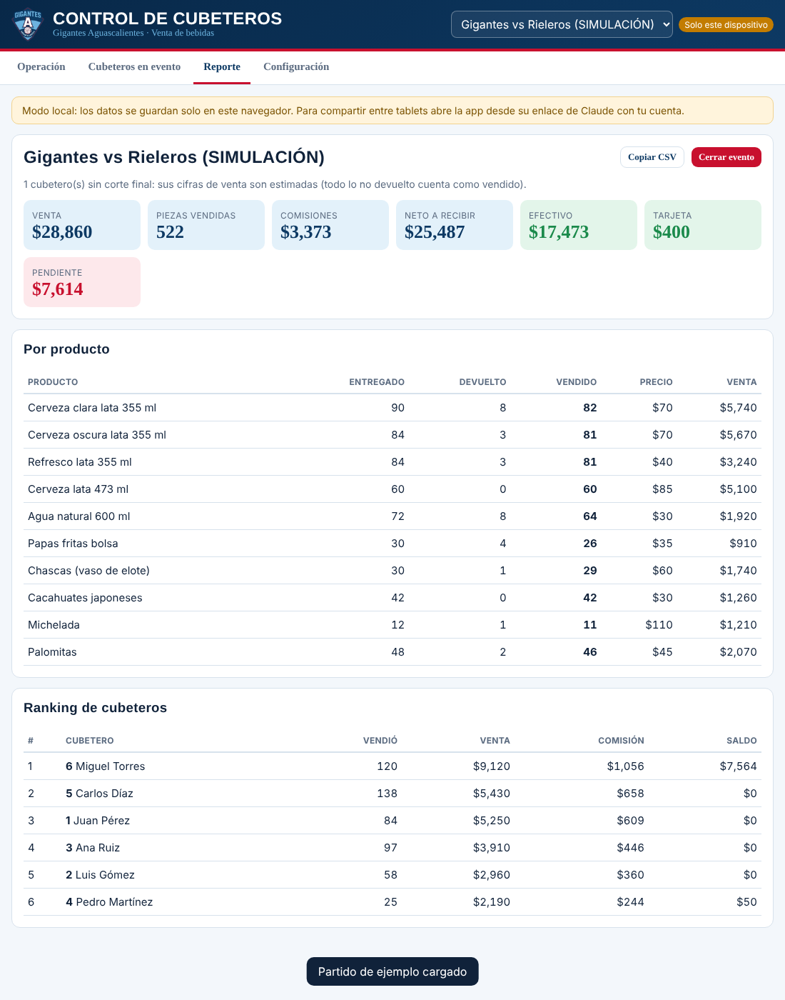

# Simulación de referencia — Gigantes vs Rieleros

Formatos impresos de ejemplo: [Ejemplo_Gafetes_y_Comanda.pdf](Ejemplo_Gafetes_y_Comanda.pdf)

Partido de ejemplo para probar el **Control de Cubeteros** y como referencia de cómo se ven los cálculos.

- **Cargarlo en la app:** Configuración → **🧪 Cargar partido de ejemplo** (funciona en Claude y en Easypanel).
- **Datos crudos:** [`simulacion-partido.json`](simulacion-partido.json) (eventos, cubeteros y movimientos).
- Cada cubetero dejó un pago parcial de **$500** a media jornada; todos tienen depósito de $200.

## Resultado por cubetero

| # | Cubetero | Entregado | Devuelto | Vendido | Venta | Comisión | Debe pagar | Pagó | Resultado |
|---|---|---|---|---|---|---|---|---|---|
| 1 | Juan Pérez | 90 | 6 | 84 | $5,250 | $609 | $4,641 | $4,641 efectivo | Liquidado |
| 2 | Luis Gómez | 66 | 8 | 58 | $2,960 | $360 | $2,600 | $2,400 efectivo + $200 tarjeta | Liquidado |
| 3 | Ana Ruiz | 102 | 5 | 97 | $3,910 | $446 | $3,464 | $3,464 efectivo | Liquidado |
| 4 | Pedro Martínez | 30 | 5 | 25 | $2,190 | $244 | $1,946 | $1,896 efectivo | **Faltan $50** |
| 5 | Carlos Díaz | 144 | 6 | 138 | $5,430 | $658 | $4,772 | $4,572 efectivo + $200 tarjeta | Liquidado |
| 6 | Miguel Torres | 120 | — | — | — | — | — | $500 parcial | **Sin corte** (sigue vendiendo) |

**Cortes cerrados (1–5):** venta $19,740 · comisiones $2,317 · a recibir $17,423 · recibido $17,373 · diferencia −$50.

## Fórmulas

- Vendido = entregado − devuelto
- Venta = vendido × precio
- Debe pagar = venta − comisión (vendido × comisión por pieza)
- Saldo = debe pagar − pagos (parciales + corte)

## Ejemplo de comanda (Pedro, #4)

| Producto | Lleva (X) | Regresa (◯) | Vendido |
|---|---|---|---|
| Cerveza clara $70 | 12 + 6 = 18 | 4 | 14 → $980 |
| Michelada $110 | 6 + 6 = 12 | 1 | 11 → $1,210 |

Venta $2,190 − comisión (14×$8 + 11×$12 = $244) = **$1,946**. Pagó $500 + $1,396 = $1,896 → **faltan $50**.
